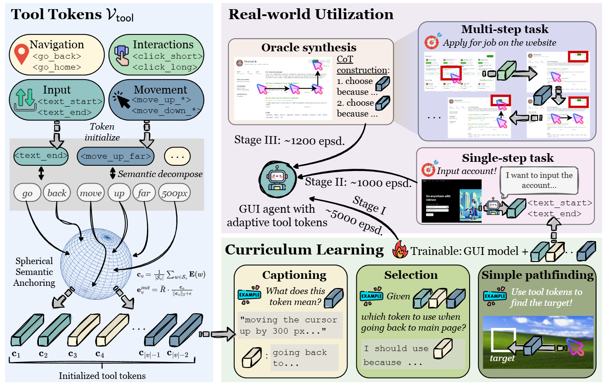
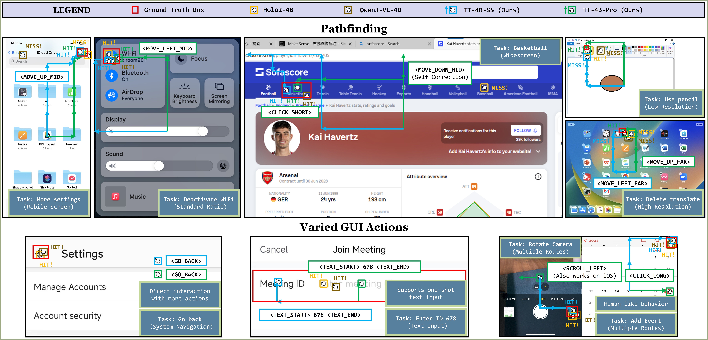
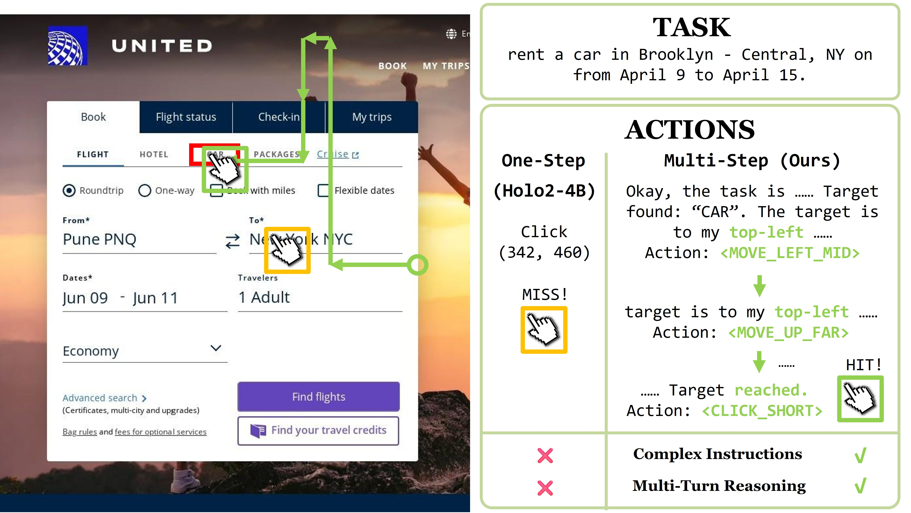

# ToolTok: Tool Tokenization for Efficient and Generalizable GUI Agents

## Description







## Train

``` shell
pip install -r requirements.txt
python scripts/download_datasets.py
python -m src.utils.generate_data
python -m src --stage init
accelerate launch -m src --stage 1
accelerate launch -m src --stage 2
accelerate launch -m src --stage 3
```

The downloader uses ModelScope exclusively and stores the snapshots at:

- `data/screenspot` (`rootsautomation/ScreenSpot`)
- `data/screenspot_pro` (`lmms-lab/ScreenSpot-Pro`, 1,581 examples)
- `data/qa_squad` (`allenai/squad`, SQuAD 1.1)

The pipeline uses ``model/Qwen3-VL-4B-Instruct`` as the base model and writes a
separate initialized checkpoint before running Stage I, Stage II, and Stage III.
Every action response has the canonical form:

```text
<think>step-by-step spatial reasoning</think>
<MOVE_RIGHT_FAR>
```

The second line must contain exactly one atomic action token. Training validates
this invariant before the first optimizer step and applies the configured action
weight only to that token. The global batch size is fixed at 8 and gradient
accumulation is adjusted automatically from ``WORLD_SIZE`` when launched with
Accelerate/DDP.

Spatial CoT is deliberately concise and resolution-independent: it first
restates the task and locates the target, then reports the signed cursor-to-bbox
gap as percentages of screen width/height, and finally explains the selected
cardinal or diagonal 25%/10%/2% move. Wording is drawn reproducibly from broad
template banks, while geometry and action facts are never randomized.

Every stage mixes 20% SQuAD supervision with 80% GUI/action supervision. SQuAD
rows use ordinary assistant language-modeling loss and are required to contain
zero action tokens; GUI rows are still required to contain exactly one atomic
action token, and only that token receives the extra action weight. The mixture
is deterministic under ``SFT_SEED``.

ScreenSpot and ScreenSpot-Pro images are capped at ``SFT_MAX_IMAGE_SIDE`` (1600
pixels by default) in the Stage II/III dataset code before they reach the
processor; bounding boxes are scaled by the same factor.

## Inference

``` shell
python -m src.eval.evaluate --help
```

Evaluation is configured entirely from the command line; editing
``src/eval/evaluate.py`` is not required. For example:

``` shell
python -m src.eval.evaluate \
  --mode trained \
  --model-path ./checkpoints/Qwen3-VL-GUI-SFT-ScreenSpot-Pro-New2 \
  --dataset screenspot \
  --limit 100 \
  --bbox-expansion 0 \
  --bbox-format xyxy \
  --max-steps 30 \
  --seed 42 \
  --temperature 0
```

Use ``--mode grounding_baseline`` to test a Qwen3-VL visual-grounding
baseline, or ``--mode api_baseline`` to test zero-shot pathfinding through the
configured VLM API. Select its remote model with ``--api-model``. Supported datasets are ``screenspot``,
``screenspot_pro``, and ``screenspot_v2``. Pass
``--limit all`` to evaluate the complete test split and ``--no-save-images``
to skip trajectory rendering.
